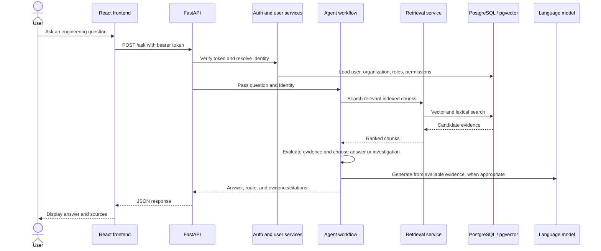
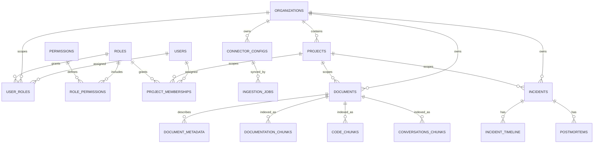
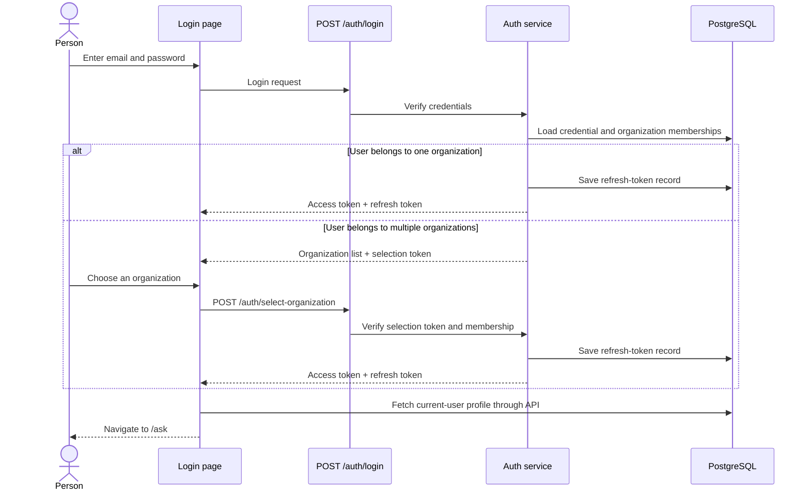
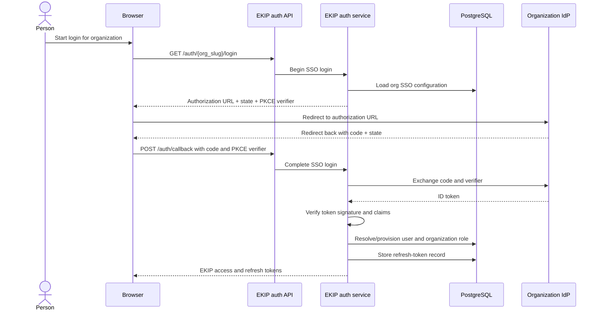

# Stage 1 — System overview

I inspected the source code and the main frontend, API, authentication, database, worker, agent, and MCP entry points. This lesson is the overview only; I’ll stop afterward for your understanding check rather than move on to signup or login internals.

## A. Purpose: what EKIP does

EKIP is for engineering teams that need to find and use knowledge scattered across their tools—such as code repositories, chat, and incident records. It brings that information into one system so people can ask engineering questions and get answers based on retrieved evidence.

The important product idea is: **when EKIP cannot find enough evidence for a reliable answer, it should investigate or say it does not know, rather than confidently inventing an answer.** That is the product goal described in `README.md`, and the answer/investigation routing is represented in `graph.py`.

For example, an engineer might ask, “Have we seen this payment timeout before?” EKIP can search indexed engineering knowledge and incident evidence, then return relevant findings and citations—or route the question into investigation if the evidence is insufficient.

## B. The basic terms

- **Organization / tenant:** The company or customer boundary in EKIP. The database uses an organization’s ID as the tenant ID; there isn’t a separate tenant entity above it. Organization records are defined in `tenancy_models.py`.
- **User:** A person with an EKIP account. A user can belong to more than one organization; membership and role assignments are stored separately from the user record, in `user_roles`. See `core_models.py`.
- **Role:** A named bundle of permissions, such as the `admin` role used in initial signup.
- **Permission:** A code representing an allowed action. The system loads these for the caller and checks them when protected actions are requested.
- **Project:** A scope within an organization, such as “Payments.” Records such as incidents and documents are associated with a project as well as an organization.
- **Connector:** A configured connection to an external knowledge source. The ingestion process uses connectors to fetch and process content.
- **Incident:** An engineering incident record, with related timeline and postmortem workflows.
- **Knowledge document:** A database record representing content from a connector or a manually proposed document/runbook. It is **not** a file in `app/core/knowledge/`.

Roles, permission assignments, and identity are covered in later lessons; I’m defining them here just enough to make the architecture map understandable.

## C. Main components

EKIP is a **modular monolith**: one application codebase with separated modules and responsibilities. It is not one undivided program, and its production-style setup runs several processes from the codebase.

| Component | Responsibility |
|---|---|
| **Frontend** | React/TypeScript UI: login, asking questions, incidents, knowledge, connectors, and settings. It lives in `frontend/src`. |
| **REST API** | FastAPI endpoints that receive browser requests and pass work to the appropriate service. Main wiring is in `main.py`. |
| **Core services** | Business rules for authentication, users, organizations, incidents, knowledge, and audit. For example, `core/knowledge/service.py` owns document proposal and review behavior. |
| **Database layer** | SQLAlchemy models, migrations, and database sessions. PostgreSQL stores organization, user, incident, document, and related records. |
| **Ingestion** | Connectors fetch external content; processing cleans and chunks it before writing records and searchable chunks. |
| **Retrieval** | Searches indexed content. The current retrieval service uses vector and lexical (text keyword) search; its facade is `retrieval/service.py`. |
| **Agents** | Orchestrate AI workflows, including question answering, investigation, postmortems, and knowledge-gap detection. |
| **MCP server** | Offers selected capabilities to MCP clients through tools and resources, using the same core/agent logic rather than a separate business-logic implementation. |
| **Workers** | Background processes that consume jobs or run scheduled tasks, so long-running ingestion and agent work does not have to run inside an HTTP request. |

**Redis** is used for background job queues. **PostgreSQL with pgvector** is used for the application database and vector-search storage. The database models for documents are in `ingestion_models.py`; searchable chunks are represented in `retrieval_models.py`.

## D. How a question travels through the system

Here is the high-level path for an authenticated user asking a question:



In plain English:

1. The user submits a question from the frontend.
2. The API checks the caller’s token and resolves their identity and permissions.
3. The agent workflow searches content indexed by the retrieval layer.
4. The workflow evaluates the evidence and decides whether to answer or investigate.
5. The API returns the result for the UI to display.

The REST question endpoint is in `routers/ask.py`; it calls the agent service in `agents/service.py`.

## E. Where the information is stored

The Python files in `app/core/knowledge/` define **how the application manages knowledge records**. They are not the documents.

The actual document records live in PostgreSQL:

- `documents` stores document-level information, such as its organization, project, source, title, and status.
- `document_metadata` stores flexible key/value data. Manually proposed document text is currently stored there under the `content` key.
- Tables such as `documentation_chunks` store text chunks and embeddings used for retrieval.

That distinction is useful: **the document record tracks ownership and lifecycle; chunks provide searchable text for the AI workflow.** The knowledge service also handles publishing or rejecting a manual proposal, including its effect on retrieval. See `core/knowledge/service.py` and `retrieval_models.py`.

## F. High-level map of the main flows

### Signup and login

The backend has both email/password and OIDC-based single sign-on (SSO) paths. For email/password signup, the service creates a new organization and its default project, creates the first user, assigns the initial admin role, and issues tokens. The corresponding service logic is in `core/auth/service.py`, with REST routes in `routers/auth.py`.

**One integration detail to be aware of:** the current `LoginPage.tsx` shows an email/password form; it does not show an SSO option there. The backend has SSO endpoints and service logic, but that alone does not demonstrate that SSO is connected to this frontend login screen.

There is also a frontend setting that affects whether the UI talks to the real API: `config.ts` defaults `VITE_USE_MOCK_DATA` to enabled unless it is explicitly set to `"false"`. So the presence of real API code does not, by itself, prove that a particular frontend build is using it.

### Authenticated REST requests

For protected endpoints, the frontend API client attaches a bearer token. The API dependency verifies the token, asks the user service to load the caller’s identity, and sets the organization context used by PostgreSQL’s Row-Level Security (RLS). RLS is a database-level filter that helps ensure queries only see rows for the selected organization.

The relevant code is in `frontend/src/api/client.ts`, `api/deps.py`, `core/users/service.py`, and `database/session.py`. I’ll trace the exact sequence and permission checks in a later lesson.

### MCP requests

MCP clients use a separate server entry point, but the design shares the same underlying authentication and core/agent services. MCP dispatch resolves the identity from the bearer token before calling a tool handler; it also records request outcomes. See `mcp/dispatch.py` and `mcp/auth.py`.

### Knowledge ingestion and AI retrieval

At a high level, a connector job fetches content, ingestion processes it, and retrieval stores searchable chunks. When a question arrives, the agent calls retrieval to search those chunks. A separate ingestion worker is configured in `ingestion/workers/main.py`; the API can enqueue work, while the worker consumes it.

The agents worker is a separate process too. It runs scheduled tasks such as knowledge-gap and pattern scans; it is not the same thing as the per-question answer flow. See `agents/workers/main.py`.

## G. What is implemented versus what deployment files establish

The source code connects the main REST routes to core services and agent services, and the repository includes configurations for separate backend, ingestion-worker, agents-worker, and MCP processes.

However, configuration files do **not** prove that a live deployment is currently running. The README says Azure infrastructure has not yet been provisioned, and the Railway guide describes dashboard setup steps rather than claiming the repo deployed itself. So I can explain the deployment shape from the repository, but I cannot confirm which services or frontend settings are active in a particular live environment from this code alone.

## H. Source files for Stage 1

These are the main files I used to establish the overview:

- `README.md` — product description and module map.
- `Architecture.md` — documented module boundaries; useful context, checked against code.
- `app/api/main.py` — REST app setup and router registration.
- `app/api/deps.py` — REST identity dependency.
- `app/api/routers/ask.py` — question endpoint.
- `app/core/auth/service.py` — signup, login, and SSO service behavior.
- `app/core/users/service.py` — identity and permission loading.
- `app/database/session.py` — database sessions and tenant context.
- `app/database/models/core_models.py` and `app/database/models/tenancy_models.py` — user, organization, role, and project records.
- `app/agents/graph.py` and `app/agents/service.py` — AI workflow structure and entry points.
- `app/retrieval/service.py` and `app/database/models/retrieval_models.py` — search and chunk storage.
- `app/mcp/auth.py` and `app/mcp/dispatch.py` — MCP identity resolution and tool execution.
- `app/ingestion/workers/main.py` and `app/agents/workers/main.py` — background worker roles.
- `frontend/src/api/config.ts`, `frontend/src/api/client.ts`, and `frontend/src/context/AuthContext.tsx` — frontend API mode and session handling.

## I. Completion

You now have the top-level mental model: the UI or an MCP client calls an entry point; authentication establishes who is acting and in which organization; core services enforce business rules; ingestion and retrieval make engineering content searchable; and agents use that evidence to answer or investigate.

## J. Understanding check

Before we move on, try these in your own words:

1. Where does EKIP store the actual knowledge text, and what is the role of the files in `app/core/knowledge/`?
2. What is the difference between ingestion, retrieval, and the agents?
3. Why does the system need to resolve an organization-specific identity before handling a protected request?
4. What did we establish about the backend’s SSO support versus the current frontend login screen?

I’ll wait for your answers before moving to the next stage.


# Stage 2 — Database entities and relationships

The goal of this lesson is to understand **what EKIP stores, how the records connect, and where tenant isolation is enforced**. Think of the database as a set of related tables: each table stores one kind of fact, and foreign keys connect those facts.

> **Important:** SQLAlchemy model files show how the application maps Python classes to database tables. Alembic migrations create or change the deployed schema. The live database only matches the repository’s current schema if its migrations have been applied. Also, `DATABASE_DESIGN.md` explicitly says parts of its earlier schema are superseded by later multi-tenant changes; for current relationships, I’m following the models and migrations.

## A. Purpose

EKIP needs to keep several kinds of information separate but connected:

- Who a person is.
- Which organizations they belong to.
- What roles they hold in each organization or project.
- Which incidents, documents, and connectors belong to which organization.
- What derived search data was created from those documents.
- What agents and users did, for auditing and troubleshooting.

Separating these facts makes them easier to query and lets the system apply organization and project boundaries consistently.

## B. A table is not a file

For example, `app/database/models/ingestion_models.py` defines the Python mapping for the database table named `documents`. It does **not** contain any customer’s document records.

A database table is like a spreadsheet maintained by PostgreSQL:

- A **row** represents one instance, such as one organization or one document.
- A **column** represents one property, such as `title` or `organization_id`.
- A **foreign key** is a database-enforced link from one row to another.

The model files live in the repo, such as `tenancy_models.py`. Actual customer data lives in the configured database.

## C. Main relationships

This diagram shows the important relationships. A line means records are linked; it does not mean every row in one table must have every possible related row.



The core organization and project records are in `tenancy_models.py`; users and organization-level role assignments are in `core_models.py`.

## D. Identity and authorization records

### Organization and project

- `organizations` stores an organization’s name, unique slug, and status.
- `projects` belongs to one organization. Each project has an `organization_id`; project names are unique **within** an organization.
- Signup creates a default “General” project, so an organization can have a project scope from the beginning.

An organization is the main tenant boundary. A project is a narrower scope inside it.

### User and roles

A subtle but important design choice: the `users` table has **no `organization_id`**. The same person’s account can belong to multiple organizations. Their membership and organization-level role are represented by `user_roles`, which connects:

- A user.
- An organization.
- A role.

The `roles` and `permissions` tables are shared catalogs. `role_permissions` connects a role to the permissions it grants. So the relationship is:

> user → organization-specific role assignment → role → permission codes

That is why a user’s account alone does not tell you what they may do in a particular organization.

Project-specific assignments are stored separately in `project_memberships`, connecting a user, a project, and a role. This allows project-level role assignments without changing the user’s organization-level membership.

The precise permission-loading and checking rules belong to the later identity/authorization lesson; here, the key is which records make that possible.

## E. Settings and membership records

Other organization-related tables include:

- `sso_configurations`: SSO provider settings for an organization. The secret is represented by a reference, not stored as a usable plaintext secret in this row.
- `external_identity_mappings`: connects an organization’s external identity-provider subject to an EKIP user.
- `connector_configs`: a configured external source such as GitHub or Slack. It belongs to an organization and may optionally be scoped to a project. It stores source settings in JSON and a credential reference.
- `organization_access_rules`: rules that can allow SSO-based organization provisioning, for example by email domain or identity-provider group.
- `invitations`: an invitation for a particular email to join an organization with a specified role.

These are all defined in `tenancy_models.py`. Their presence in the schema does not, by itself, establish that every related screen or workflow is available in the deployed frontend; we’ll trace those paths later.

## F. Documents and searchable chunks

The document model in `ingestion_models.py` represents content from two different sources:

1. **Ingestion:** content synchronized from a connector.
2. **Manual proposal:** knowledge content submitted for review.

A `documents` row identifies the organization and project, source, title, status, and version. Flexible source-specific details go in `document_metadata`, which is associated with a document by `document_id`.

For manually proposed documents, the text is currently stored in `document_metadata` under the key `content`; there is no `documents.content` column. That’s why the earlier explanation said the files in `app/core/knowledge/` are business logic, not the documents themselves.

The retrieval layer stores **derived chunks** in tables such as `documentation_chunks`, `code_chunks`, and `conversations_chunks`, defined in `retrieval_models.py`. A chunk holds text, its embedding (a numerical representation used for semantic search), and offsets back into the source text.

In other words:

> `documents` and `document_metadata` represent the source record and its details; chunk tables represent searchable, derived copies of its content.

Chunk rows repeat organization and project IDs so retrieval can filter efficiently. They also point back to the document. The database enforces uniqueness for each document’s chunk index within a collection.

## G. Incidents, history, and generated work

The main incident records are in `core_models.py`:

- `incidents` stores an incident’s organization, project, reporter, status, severity, title, and description.
- `incident_timeline` stores chronological events for an incident, such as notes or status changes.
- `postmortems` stores postmortem content and its review status.

Timeline entries label their actor as a string such as `user:<id>` or `agent:<name>`. This lets the record represent an agent action even though an agent is not a row in `users`.

There are also tables that record activity rather than the primary business objects:

- `audit_logs` records auditable actions, such as document publication.
- `agent_executions` records agent runs and their outcomes.
- `knowledge_gap_reports` stores documentation-gap recommendations, which may refer to an existing document.

These models are in `core_models.py` and `agent_models.py`. Audit records and agent execution records answer different questions: **audit logs describe actions; agent executions describe AI runs.**

## H. Tenant isolation: organization IDs and RLS

Many business tables store `organization_id` directly. The application also sets a transaction-local PostgreSQL setting, `app.current_organization_id`, after resolving the caller’s organization. See `database/session.py`.

The RLS migration, `c7d4e8f19a2b_milestone_10_row_level_security.py`, configures policies that compare a row’s organization to that setting. For tables without their own `organization_id`, it scopes them through a parent:

- `document_metadata` is scoped through its document.
- `project_memberships` is scoped through its project.

This is a database-level backstop: if the application accidentally queries without an organization filter, the database should still restrict which tenant’s rows are visible. If the context is missing, the migration’s policy is designed to fail closed—queries return no protected tenant rows, rather than every organization’s rows.

RLS is not the same as role/permission authorization. **RLS limits which organization’s rows the database can access; permission checks decide whether the caller may perform a particular action.** The permission-check details come in a later stage.

## I. Example: Alice, Bob, Payments, and another company

Suppose Alice and Bob belong to **Acme**, which has a **Payments** project. Bob also must not access **Globex**, a separate organization.

- `organizations` contains one row for Acme and one for Globex.
- `projects` contains a Payments row linked to Acme.
- `users` contains Alice and Bob as person accounts; neither row needs an organization ID.
- `user_roles` contains the assignments that say which roles Alice and Bob have **in Acme**. Membership in Globex would require its own assignment.
- `project_memberships` can give Bob a role specifically in Payments.
- A Payments incident or document has `organization_id = Acme` and `project_id = Payments`.
- When Bob makes a request scoped to Acme, the database transaction gets Acme’s tenant context. RLS then prevents that database session from reading Globex’s tenant-scoped records.

So, **Bob’s user record identifies the person, but the organization-scoped membership and the request’s tenant context determine which company’s data is in scope.**

## J. Important code locations

- `tenancy_models.py` — organizations, projects, connector settings, invitations, and access rules.
- `core_models.py` — users, roles, permissions, incidents, timeline, postmortems, and audit logs.
- `ingestion_models.py` — ingestion jobs, documents, and document metadata.
- `retrieval_models.py` — chunk and vector-search tables.
- `agent_models.py` — agent execution and knowledge-gap records.
- `session.py` and `the RLS migration` — tenant context and database-level isolation.

## Completion

You now have the database mental model: an account is separate from organization membership; roles connect to permissions; projects scope work within organizations; source documents and searchable chunks are separate; and database RLS adds an organization-level safety boundary.

## Understanding check

Before I continue to **Stage 3: organization signup and initial admin setup**, answer these in your own words:

1. Why does the `users` table not need an `organization_id`?
2. What is the difference between a `documents` row and a row in `documentation_chunks`?
3. How are `user_roles` and `project_memberships` different?
4. What does RLS protect, and how is that different from a permission check?


# Stage 3 — Organization signup and initial admin setup

## A. Purpose

Signup does more than create a login. It bootstraps a new EKIP customer space:

- A new organization
- Its initial project
- The first user account
- An organization-level admin role for that user
- A session so the user is signed in immediately

The key result is: **the person’s account is created, and that account is given admin access inside the new organization.**

## B. What starts the flow?

In the frontend, the user visits the signup page, fills in their name, work email, password, and organization details, then submits the form. The organization slug is suggested from the organization name, but the user can edit it. See `SignupPage.tsx`.

The frontend calls `POST /auth/signup`. The endpoint is public, returns `201 Created` on success, and applies a rate limit of 10 signup requests per IP per minute. See `auth.py`.

**Frontend caveat:** the frontend defaults to mock data unless `VITE_USE_MOCK_DATA=false`. If mock mode is enabled, signup returns a mock session instead of contacting the real backend. See `config.ts`.

## C. What does the request contain?

The backend expects:

- `email`
- `password` — at least 8 characters
- `display_name`
- `organization_name`
- `organization_slug` — lowercase letters and numbers, separated by single hyphens

These rules are in `schemas.py`. The password is hashed with bcrypt before being stored; the plaintext password is not saved. See `service.py`.

## D. Step-by-step execution

When the real backend receives the request, the signup service does the following:

1. **Check whether the email already has an account.**  
   If it does—including an account originally created through SSO—signup returns an “email already exists” conflict. Signup is not a way to join an existing organization.

2. **Create the organization and its default project.**  
   The organization is created with the submitted name and slug. The tenancy service also creates a default project named **General**. The organization begins with status `onboarding`. See `tenancy service` and `tenancy models`.

3. **Create the user account and password credential.**  
   The `users` row stores the person’s email and display name. Its `password_hash` stores the bcrypt hash. The user row itself has no `organization_id`; the organization relationship is added in the next step. See `core models`.

4. **Give the user the admin role in this organization.**  
   The system ensures the shared `admin` role and its permission grants exist, then creates a `user_roles` assignment linking this user, this organization, and that role. This is how the app knows the user is an admin *in this organization*. See `users service`.

5. **Issue a session.**  
   The backend returns an access token and a refresh token. The refresh token is persisted, and the session is scoped to the new organization. See `auth service`.

6. **Load the signed-in user in the frontend.**  
   The frontend stores the tokens, uses the access token to fetch the current user and their organization-specific permissions, then the signup page navigates to `/ask`. See `AuthContext.tsx` and `SignupPage.tsx`.

## E. Data movement

```mermaid
sequenceDiagram
    actor Person
    participant UI as Signup page
    participant API as POST /auth/signup
    participant Service as Auth and tenancy services
    participant DB as PostgreSQL
    participant Browser as Frontend session

    Person->>UI: Submit account and organization details
    UI->>API: Signup request
    API->>Service: Validate and provision
    Service->>DB: Check email; create organization and General project
    Service->>DB: Create user and password hash
    Service->>DB: Ensure admin role; assign it within organization
    Service->>DB: Save refresh-token record
    Service-->>API: Access token + refresh token
    API-->>UI: Session tokens
    UI->>Browser: Store tokens and load current-user profile
    UI-->>Person: Navigate to /ask
```

The request uses one database session. It commits when the request succeeds and rolls back if an error is raised, so a failed signup should not leave only some of the records behind. See `session.py`.

## F. Security and behavior to remember

- **Signup creates a new organization.** It does not let someone join an existing one. Inviting another person is a separate flow.
- **Email uniqueness is global.** One person has one `users` record, even if they later belong to multiple organizations.
- **The admin assignment is organization-scoped.** The role assignment ties the user to this organization; the role catalog itself is shared.
- **Tenant context is set during provisioning.** The database uses it to allow tenant-scoped writes such as creating the default project.
- **The endpoint is rate-limited.** That limits repeated signup attempts from a single IP.
- **A duplicate organization slug is rejected.** The slug is unique; there is a narrow concurrency case where the database uniqueness constraint may reject a simultaneous duplicate request less cleanly than the normal conflict response.

## G. Example

Suppose Priya signs up with organization name **Acme Engineering** and slug **acme-engineering**. The backend creates:

```text
organizations
  Acme Engineering / acme-engineering / onboarding

projects
  General / belongs to Acme Engineering / default

users
  Priya's email / Priya's name / bcrypt password hash

user_roles
  Priya / Acme Engineering / admin
```

It then issues Priya a session scoped to Acme Engineering. The app can use that identity and its permissions on the next request.

## Completion and understanding check

The signup flow turns a visitor into the first administrator of a newly created organization: it provisions the organization and `General` project, creates the account, assigns the admin role within that organization, and signs the user in.

Before I continue to the next stage, answer these in your own words:

1. Why does signup create an organization and a `General` project, rather than just a user?
2. Where is the fact “this user is an admin in this organization” stored?
3. What happens if someone tries to sign up with an email that already belongs to an SSO-created account?
4. What frontend setting determines whether signup reaches the real backend or uses mock data?


# Stage 4 — Email/password login

## A. Purpose

Signup created the account and the first organization. Login is how someone with an existing account proves their identity and gets a session to use EKIP.

The important detail is that **a person’s account and their organization are separate**. After validating the password, EKIP also needs to know which organization’s data and permissions to use.

## B. What starts the flow?

The user enters their email and password on the login page. The frontend sends them to `POST /auth/login`. This endpoint is rate-limited to 10 requests per IP per minute. See `LoginPage.tsx` and `auth.py`.

As with signup, the frontend defaults to mock mode unless `VITE_USE_MOCK_DATA=false`; in mock mode, it does not contact the real login endpoint. See `config.ts`.

## C. Step-by-step execution

1. **Look up the account by email.** The backend retrieves the credential record for that email.

2. **Verify the password.** It compares the entered password with the stored password hash. An unknown email, a wrong password, or an account without a password credential (such as an SSO-only account) gets the same “Invalid email or password” response. This avoids revealing which emails have accounts.

3. **Check account status and organization memberships.** An inactive account is rejected. If the user has no organization membership, login is also rejected.

4. **Choose the right login outcome based on memberships:**
   - **One organization:** EKIP issues a session for it immediately.
   - **More than one organization:** EKIP does **not** choose one automatically. It returns a list of organizations and a short-lived `selection_token`, but no access token yet.

5. **If needed, let the user choose an organization.** The frontend shows an organization picker. When the user chooses, it sends the selection token and organization ID to `POST /auth/select-organization`. The backend checks that the user really belongs to that organization before issuing a session. The organization ID from the browser is a request—not proof of membership.

6. **Load the signed-in profile.** Once the frontend has session tokens, it stores them and fetches the current user’s profile for the selected organization. It then navigates to `/ask`.

The password and organization-membership logic is in `service.py`. The frontend’s token and profile handling is in `AuthContext.tsx`.

## D. What is the `selection_token`?

It is **not** an access token. It proves that the password check succeeded and allows the user to complete the organization-selection step. On its own, it does not grant access to protected API data. Only after the backend verifies membership in the selected organization does it issue the real access and refresh tokens.

That distinction prevents “I know a user’s organization ID” from being enough to sign in as them.

## E. What does the session provide?

- The **access token** is used to authenticate requests, and is scoped to one organization.
- The **refresh token** lets the frontend request a new access token later without making the user repeat the full login.

Once a session exists, the backend can resolve the user’s identity and permissions within the organization in that session. The next stage will explain that identity and authorization process in more detail.

## F. Login flow diagram



## G. Key takeaways

- A correct password proves the person’s account, but it does not by itself choose an organization.
- A single-organization user goes straight to a session.
- A multi-organization user must choose; the server independently verifies that membership.
- The login screen is an email/password form. The backend also has SSO paths, but those are a separate flow.
- Mock mode can make the frontend appear to log in successfully without calling the real backend.

## Understanding check

Before I continue to the next stage, answer these in your own words:

1. Why does EKIP ask a multi-organization user to choose an organization after password verification?
2. What does the `selection_token` prove, and what does it *not* grant?
3. Why do unknown emails and wrong passwords receive the same error?
4. What is the difference between the access token and the refresh token?


# Stage 6 — SSO login with OIDC

This lesson follows the email/password and identity-resolution lessons. SSO is a second way to prove who a user is: instead of checking a password stored by EKIP, the user authenticates with their organization’s identity provider (IdP), such as Microsoft Entra ID, Okta, Auth0, or Google Workspace.

The SSO implementation is **partly connected**: the backend has OIDC login and the frontend has an SSO settings screen for administrators, but the current login page does not offer a “Sign in with SSO” flow. So the backend capability and its configuration UI exist, but the full employee-facing browser journey is not wired into that login page.

## 1. An administrator configures the organization’s IdP

Before employees can sign in through SSO, the organization needs an SSO configuration. It identifies the provider, issuer URL, client ID, and client secret.

In the current frontend, an administrator can enter these under **Settings → SSO**. The API requires the `tenancy:manage` permission. The backend encrypts the client secret before storing it and does not return the real secret to the browser when the configuration is read back. See `SsoSettingsPage.tsx` and `service.py`.

The database stores the configuration in `sso_configurations`, linked to one organization. Although the configuration schema recognizes `oidc` and `saml` as protocol values, the login flow described here performs **OIDC** discovery and authorization-code exchange. That protocol choice in the settings schema does not, by itself, mean there is a working SAML login flow. See `tenancy_models.py` and `schemas.py`.

## 2. The user starts login for a particular organization

The backend login entry point is:

```text
GET /auth/{org_slug}/login?redirect_uri=...
```

The organization slug tells EKIP which organization’s IdP configuration to use. For example, the request identifies Acme’s configuration rather than asking the user to choose from every organization in the system.

The backend checks that the redirect URI’s **origin** is in the deployment’s allowed CORS origins. It then finds the organization by slug, loads its SSO configuration, and discovers the IdP’s authorization endpoint using its OIDC discovery document. Discovery results are cached for an hour. See `auth.py` and `service.py`.

## 3. EKIP prepares a protected authorization request

Before sending the user to the IdP, EKIP generates two random values:

- **`state`**: correlates the login attempt and is intended to protect the redirect round-trip against cross-site request forgery.
- **`code_verifier`**: a secret value used by PKCE to prove that the party completing login started it.

EKIP derives a **`code_challenge`** by hashing the verifier with SHA-256, then builds an authorization URL containing the client ID, redirect URI, requested OIDC scopes (`openid email profile`), state, and PKCE challenge. The verifier itself is not sent as the challenge. See `service.py` and `schemas.py`.

The API returns the authorization URL, state, and verifier to the caller. The intended browser client stores the state and verifier for this particular login attempt, then redirects the user to the IdP.

## 4. The IdP authenticates the user

The IdP presents its own login and any organization-required checks, such as multifactor authentication. EKIP does not see or validate the user’s IdP password; that is handled by the IdP.

After successful authentication, the IdP redirects the browser back to the configured callback URI with an authorization **code** and the state value. The code is temporary; it is not EKIP’s access token.

## 5. The callback exchanges the code for verified claims

The callback endpoint is:

```text
POST /auth/callback?redirect_uri=...
```

Its body includes the organization slug, authorization code, state, and PKCE verifier. The redirect URI must match the one used to begin login.

The auth service loads the organization’s SSO configuration and exchanges the authorization code at the IdP’s token endpoint. It decrypts the stored client secret for this exchange and sends the code verifier, allowing the IdP to check that the caller has the PKCE secret corresponding to the original challenge.

EKIP then retrieves the IdP’s JWKS signing keys and verifies the returned ID token. It checks the token’s signature, issuer, audience, and expiry before trusting its claims. The implementation requires an email claim; it also reads the subject, optional name, and standard `groups` claim. Provider-specific custom group claims and directory lookups are not implemented in this path. See `service.py`.

## 6. EKIP decides whether this person may join the organization

A verified IdP login proves identity to EKIP; it does **not automatically mean the person is authorized to join that EKIP organization**.

If EKIP already has a mapping for this IdP subject and organization, it reuses the associated EKIP user. Otherwise, it evaluates the organization’s provisioning rules in this order:

1. A valid pending invitation for the user’s email.
2. An active rule matching the email domain.
3. An active rule matching one of the IdP’s standard `groups` values.

A matching rule must specify which role to grant. If no rule or valid invitation matches, EKIP denies provisioning and does not issue a session. See `service.py`.

If access is allowed, EKIP finds or creates the global `users` account, assigns the chosen role **within this organization**, accepts a matched invitation if applicable, and writes an `external_identity_mappings` row linking the organization and IdP subject to that EKIP user. That mapping makes later logins resolve back to the same user account. See `service.py` and `tenancy_models.py`.

## 7. EKIP creates its own session

Once the identity is mapped or provisioned, EKIP issues its own access and refresh tokens, scoped to the organization whose IdP was used. From then on, protected requests use EKIP’s normal identity-resolution process—the same general authorization path as other signed-in users.

The important distinction is:

> **The IdP authenticates the person. EKIP decides whether that person may join the organization, assigns their EKIP role, and issues an EKIP session.**

## Full flow at a glance



## What is implemented, and what is not connected?

**Implemented in the backend:**

- Organization-specific OIDC configuration lookup
- Authorization-code login with PKCE
- IdP token verification
- Invitation/domain/group-based just-in-time provisioning
- Mapping IdP identities to EKIP users
- EKIP session issuance

**Present in the frontend:**

- An administrator’s SSO configuration page

**Not shown as connected in the current employee login screen:**

- A button or flow to begin SSO login
- Browser handling that stores the state/verifier, redirects to the IdP, receives the callback, and submits it to the API

There is also an important boundary in the implementation: the auth-service documentation says the caller is expected to match the callback’s `state` with the saved login attempt before completion. The visible callback router passes the submitted data to the service, but does not itself show that state lookup or comparison. Because the current login page does not implement SSO, I can’t confirm from these files that a browser callback client performs that required check.

## Example

Suppose Acme has configured Entra ID and has an active rule allowing `acme.example` email addresses to join as engineers.

- Priya signs in with Entra ID.
- Entra returns a verified ID token for her.
- EKIP checks whether her IdP subject is already mapped.
- If not, EKIP checks her invitation or access rules. Her email domain matches Acme’s rule.
- EKIP creates or reuses Priya’s user account, assigns the engineer role in Acme, records the external identity mapping, and issues an Acme-scoped EKIP session.

If she later signs in again through that same organization and IdP subject, EKIP can use the mapping rather than provisioning her again.

## Understanding check

Before I continue, try these in your own words:

1. What does the IdP authenticate, and what does EKIP still decide after receiving the IdP result?
2. Why does EKIP use both `state` and a PKCE verifier/challenge?
3. What are the three provisioning routes EKIP checks for a first-time SSO user?
4. What is the difference between `external_identity_mappings` and `user_roles`?
5. Which part of the SSO journey is configured in the frontend, and which employee-facing part is not currently visible in the login page?


# Stage 7 — Using and maintaining a signed-in REST session

Stages 3–6 covered how an account is created, how a user signs in, and how EKIP resolves their identity. This stage follows the session into normal API use: what happens on each protected request, how the browser restores a session after a reload, and what refresh and logout do.

## 1. The browser holds two different tokens

After successful signup or login, EKIP returns an **access token** and a **refresh token**. They serve different purposes:

- The **access token** goes in the `Authorization: Bearer …` header on protected API calls. It contains the user and organization claims and is signed so the backend can verify it.
- The **refresh token** is a longer-lived credential that can be exchanged for a new token pair when the access token expires.

In this project, the access token lasts **60 minutes by default** (`jwt_expiry_minutes`). The refresh-token lifetime is **30 days**. See `settings.py` and `service.py`.

The browser stores these differently: the access token stays **in memory**, while the refresh token is stored in `localStorage`. So a page reload loses the in-memory access token, but the browser can use the stored refresh token to get a replacement. See `tokenStore.ts`.

## 2. A normal protected API request

Imagine the user submits a question to `POST /ask`. The frontend’s shared API client attaches the access token to the request. The `/ask` route declares a `CurrentIdentity` dependency, so FastAPI resolves and verifies the caller before the route handler runs.

The process is:

1. **Attach the bearer token.**  
   The client reads the access token from memory and adds it to the `Authorization` header. Resource API calls use the shared `apiRequest` helper. See `client.ts`.

2. **Extract and verify the token.**  
   The API requires a bearer token and asks the auth service to validate its signature, expiry, and token type. An organization-selection token, for example, is not accepted as an access token. This verification is about the token’s validity and its claims; it does not yet load the user’s permissions. See `deps.py` and `service.py`.

3. **Build the user’s current identity.**  
   The API takes the user ID and organization ID from the verified claims and calls the user service. That service checks that the user exists and is active, then loads their roles and permissions for that organization. The result is an `Identity` object passed into the endpoint. See `users service` and `identity.py`.

4. **Set the database tenant context.**  
   The organization from the verified token is placed into the PostgreSQL transaction’s tenant context. RLS then restricts tenant-owned rows to that organization for the transaction. This protects the data boundary, but does not grant action permissions. See `session.py`.

5. **Check permission and perform the work.**  
   The route or a service can check that the identity has the permission needed for the operation. For example, the `/ask` route passes the identity to the agent service; a route that manages SSO settings requires `tenancy:manage`. If the required permission is absent, the action is denied. See `ask.py` and `users service`.

6. **Finish the request transaction.**  
   The database session commits if the request succeeds, rolls back if an error occurs, and is then closed. See `session.py`.

```text
Browser sends access token
        ↓
FastAPI resolves CurrentIdentity
        ↓
Verify signature, expiry, and token type
        ↓
Load active user, roles, and permissions for the token's organization
        ↓
Set PostgreSQL tenant context
        ↓
Check permission, then run the endpoint
        ↓
Commit on success; rollback on error
```

The token is not a complete snapshot of all permissions. EKIP loads roles and permissions from the database while resolving the identity, then uses the resulting `Identity` for the request.

## 3. What happens when the page reloads?

A reload clears the in-memory access token. On startup, `AuthContext` checks whether a refresh token is stored:

1. If none exists, it finishes loading as unauthenticated.
2. If one exists, it sends that token to `POST /auth/refresh`.
3. If refresh succeeds, the frontend stores the new access and refresh tokens, then fetches the current user’s profile.
4. If refresh fails, the frontend clears the stored session and user state.

Refresh tokens are **single-use and rotated**: the token presented to the refresh endpoint is revoked, and a new refresh token is returned. Because two simultaneous refreshes with the same token could look like token reuse, the frontend coalesces concurrent refresh calls into one request. See `AuthContext.tsx` and `tokenStore.ts`.

## 4. Refresh-token rotation and reuse detection

When the backend receives `POST /auth/refresh`, it:

1. Hashes the presented refresh token and looks up its organization.
2. Sets the tenant context, then performs the RLS-scoped lookup.
3. Rejects the token if it is unknown or expired.
4. If the token has already been revoked, treats that as possible reuse and revokes the rest of its token family.
5. Otherwise, revokes the presented token and issues a fresh access/refresh pair in the same family.

The database stores the **hash** of the refresh token, not the raw value. Each token in a refresh chain shares a `family_id`, which lets EKIP revoke the chain if an already-rotated token is presented again. See `auth_models.py` and `service.py`.

## 5. What happens if an API request gets a 401?

The API client detects a `401` on a request that carried an access token. It clears both stored tokens and notifies `AuthContext`, which clears its user state. That makes the app’s normal protected-route behavior send the user to login. See `client.ts` and `tokenStore.ts`.

**Important distinction:** the frontend restores the session with a refresh call on startup, but the shared API client does **not** currently perform silent refresh-and-retry when an ordinary API request gets a 401. So an expired access token during an active session can cause the session to be cleared instead of transparently refreshed.

A 401 from a request with **no access token attached**—such as an incorrect password on login—does not trigger the “session expired” behavior. There is no existing signed-in session to clear.

## 6. Logout options

EKIP has two logout paths:

- **`POST /auth/logout`** takes a refresh token and revokes that one session’s refresh token. The frontend then clears its local token and user state.
- **`POST /auth/logout-all`** requires a valid current identity and revokes active refresh-token sessions for that user in the current organization. It also records an audit event.

The access token is a signed, stateless JWT; ordinary access-token verification does not look up the refresh-token row. Therefore, revoking a refresh token prevents future refreshes, but does not itself invalidate an already-issued access token immediately. That token can remain usable until it expires. See `auth.py` and `service.py`.

## 7. Where does `GET /auth/me` fit?

After signup, login, or refresh, the frontend calls `GET /auth/me` to load the signed-in user’s profile—such as their name, roles, and permissions. This route is protected by the same `CurrentIdentity` mechanism as other protected routes. It does not accept a user ID from the browser to decide whose profile to return; it uses the identity resolved from the token. See `auth.py`.

## Example: the user reloads EKIP

Priya signed in to Acme and has a refresh token saved in the browser. She closes and reopens the page:

1. The access token is gone because it was only held in memory.
2. The app finds the refresh token in `localStorage`.
3. It sends that token to the backend.
4. The backend validates it, marks it used, and returns a new access token and refresh token.
5. The app stores the new pair and loads Priya’s Acme profile.
6. When Priya submits an authenticated request, the API verifies the access token and resolves her Acme-scoped identity.

## Main takeaway

The **access token** is what accompanies routine API calls; the **refresh token** is the credential used to obtain a replacement session. On each protected REST request, EKIP verifies the access token, resolves the user’s current organization-specific identity, sets tenant context, and lets permissions and RLS protect different boundaries.

## Understanding check

1. Why does the browser persist the refresh token but keep the access token only in memory?
2. What does refresh-token rotation do, and why does EKIP track a token family?
3. What is the difference between revoking a refresh token and invalidating an already-issued access token?
4. Does the frontend transparently refresh and retry an ordinary API request after a 401?


# Stage 8 — Organization, project, and team management

Now that we’ve seen how a user signs in and gets an organization-scoped session, let’s look at what they can do inside that organization: view teammates, invite people, configure SSO join rules, and work with projects.

A useful distinction throughout this stage:

- **Implemented API capability** means the backend has a route and service logic for it.
- **Visible UI capability** means the frontend provides a screen or control to use it.
- Having a database table for something does not automatically mean the app has a complete workflow to manage it.

## 1. The current organization comes from the session

After sign-in, the access token is scoped to one organization. The frontend uses that token to load the user’s organization memberships, then identifies the current organization from the organization ID in the token—not by simply choosing the first organization in the list.

If the user belongs to more than one organization, the frontend’s tenant switcher can request a switch. The backend verifies the user’s membership and issues a **new token pair** scoped to the selected organization. The UI does not make itself a member just by changing a displayed organization ID. This is handled by `TenantContext.tsx` and the organization-switch endpoint in `auth.py`.

Once the current organization is known, the app loads that organization’s projects and uses the selected project as UI context. The organization is the tenant boundary; a project is a narrower scope within that organization.

## 2. Organization settings: currently read-only

The organization settings page displays its name, slug, and ID. Those fields are disabled because the backend currently supports creating and reading an organization, but has no update-organization operation. So the settings page is not a form that saves changes; it is a display of the current organization’s details. See `OrganizationSettingsPage.tsx`.

The backend does have an endpoint to create an additional organization, but that is different from editing the current one. Creating another organization requires `tenancy:manage`. For the ordinary organization list, the user sees only their own current organization from that API surface; internal scheduled jobs have a separate unscoped listing for system work.

## 3. Projects: what the API can do versus what the UI does

An organization gets a **General** project during signup. It provides a project scope from the start, even for customers who never divide their work into multiple teams.

The backend supports:

- Listing projects belonging to the caller’s organization.
- Creating a project, provided the caller has `tenancy:manage`.

Creating a project records an audit event. The project model stores its name, organization ID, and whether it is the default project. See `tenancy.py`, `service.py`, and `tenancy_models.py`.

The frontend’s Project settings page is more limited: it displays the active project and the project list, but does not offer a create or edit form. There is no backend project-update operation, either. The tenant switcher can select a project in frontend state; that selection is not the same as assigning a user a role on that project. See `ProjectSettingsPage.tsx` and `TenantSwitcher.tsx`.

**Important gap:** the database has a `project_memberships` table and identity resolution can load project-specific permissions, but I did not find a corresponding project-membership management endpoint or service flow. In other words, the schema supports that model, but an administrator cannot currently use the visible UI to assign project-specific roles.

## 4. The Users page shows members and invitations separately

The Users settings page has two related but distinct views:

1. **Users**: people who already have a role assignment in the organization.
2. **Invitations**: invitations that have been created but may not yet have been accepted.

The members endpoint returns users who hold a role in that organization. The current service allows an organization member to view teammate names, emails, and roles; it does not require `tenancy:manage` just to view the member list. See `users service` and `tenancy.py`.

The frontend simplifies roles to one displayed role per user. The backend can return multiple role names, but the UI shows the first one it receives; that should not be read as “the user has exactly this one role” or necessarily “this is their most powerful role.” Also, the membership list represents people who have joined, not pending invitations. See `tenancy.ts` and `UsersSettingsPage.tsx`.

## 5. Inviting someone to join

An administrator with `tenancy:manage` can create an invitation for an email address and specify the role to grant. The server checks that the invitation is for the caller’s own organization and resolves the requested role name to an existing role. If an invitation for that email is already pending in that organization, it rejects the duplicate.

The backend then:

1. Generates a random invitation token.
2. Stores only a hash of that token—not the raw secret.
3. Saves the invitation with its organization, email, role, inviter, expiry, and `pending` status.
4. Returns the raw token **once**, in the creation response, so it can be put into an invitation link.
5. Records an audit event.

The invitation is not yet the same as a member assignment: the invitee only becomes a member after successfully accepting or joining through an allowed SSO flow. See `service.py` and `tenancy_models.py`.

### A practical UI limitation

The frontend creates a link and offers to copy it, but the app does **not** send invitation emails. An administrator has to share the link through another channel. Since the raw token is returned only at creation time and is not recoverable from the stored hash, if the link is lost, the admin must revoke the invitation and create another one. See `UsersSettingsPage.tsx`.

## 6. Accepting an invitation with a password

For a password-based organization, the invitee opens a link containing both:

- The invitation ID, which identifies the database record.
- The invitation token, which proves possession of the secret link.

The invitee enters a password and may enter a display name. The backend checks that the token matches the stored hash, that the invitation is still pending, and that it has not expired. It then creates or reuses the user account, sets the password, grants the invitation’s role in the target organization, marks the invitation accepted, and issues a session.

The raw token—not the invitation ID—is the proof that the person has the invitation link. The accept endpoint is public because the invitee does not have a session yet, but it is rate-limited and requires that token. See `AcceptInvitationPage.tsx`, `auth.py`, and `service.py`.

## 7. Invitation versus SSO access rules

Invitations are **individual and specific**: one email address, one organization, and one role.

Access rules are **broader SSO provisioning policies**. An administrator can allow users to join based on either:

- A verified email domain, such as `acme.example`.
- A group in the IdP’s standard `groups` claim, such as `engineering`.

The rule also specifies which role the newly provisioned user receives. On first SSO login, EKIP checks a valid invitation first, then an active matching domain rule, then an active group rule. If none match, provisioning is denied. An access rule does not itself create a user at the time it is configured; it is evaluated when an SSO login occurs. See `AccessRulesSettingsPage.tsx` and `service.py`.

An inactive access rule can be deactivated, but the current API does not provide a reactivation operation. Similarly, SSO can be configured from the settings screen, but replacing an existing configuration is not supported by the current backend flow.

## 8. Where roles fit—and what isn’t managed yet

Both invitations and SSO access rules name a role to grant. The service looks up that role by name; it does not invent a new role when an invitation or rule is saved.

The app automatically creates the `admin` role and its permissions during signup. The current UI defaults invitation roles to `admin` and warns that this is the only role the app creates automatically today. It also accepts free text for a role, but an unknown role will be rejected by the backend.

This means the role catalog and role assignment are not yet fully administered through this screen: the UI does not offer a role picker backed by a list-roles endpoint, and there is no visible control here for changing an existing member’s role.

## Whole flow at a glance

```text
Organization admin
    │
    ├── creates an invitation for one email
    │       └── shares the one-time link manually
    │               └── invitee proves possession, sets password,
    │                   receives role + EKIP session
    │
    ├── configures an SSO access rule
    │       └── a verified SSO user matches invite/domain/group policy
    │               └── EKIP provisions user, grants role, records mapping
    │
    └── creates organization projects
            └── projects scope records within the organization
```

## What is actually available in the app?

- **Available:** view organization details; list projects; select a project in the UI; create projects through the backend API; list organization members; invite and revoke invitations; accept a password invitation; configure and deactivate SSO access rules.
- **Limited or absent:** organization editing; project editing; a project creation form in the frontend; project-member/role assignment management; editing existing member roles; automatic invitation email delivery; reactivating a deactivated access rule.
- **Remember:** the frontend defaults to mock data unless `VITE_USE_MOCK_DATA=false`. In mock mode, the screens may show simulated results rather than exercising these real backend flows. See `config.ts`.

## Understanding check

1. What’s the difference between an organization member and a pending invitation?
2. Why does the invitation link need both an invitation ID and a separate token?
3. How does an access rule differ from an invitation?
4. Which project-management features exist in the backend but are not exposed as controls in the current UI?


# Stage 9 — MCP: connecting AI clients to EKIP

The lesson notes currently stop at Stage 8, so **Stage 9 is the next topic by sequence, not a numbered stage already written in the notes**. We’ll look at how a client such as an AI assistant connects to EKIP through MCP, how it authenticates, and what happens when it calls a tool or reads a resource.

## 1. What MCP provides

MCP is a protocol for exposing capabilities to AI clients. In EKIP, it exposes three kinds of things:

- **Tools** — actions the client can ask EKIP to perform, such as asking a question, investigating an incident, or creating a project.
- **Resources** — information the client can read using a URI, such as an incident or knowledge document.
- **Prompts** — reusable instruction templates, such as a prompt that tells the client how to approach incident triage.

The MCP layer is an **interface**, not a second implementation of EKIP’s business logic. Its handlers are designed to validate inputs, resolve the caller, call existing services, and translate the result into MCP’s response format.

## 2. How the MCP server runs

EKIP’s MCP server is configured for **streamable HTTP**. It runs as a hosted service that can serve multiple organizations and users—not as a separate local process for every user. Its process entry point is `run_mcp_server.py`.

At startup, that entry point:

1. Imports the MCP assembly module, which registers the tools, resources, and prompts.
2. Supplies the server with a database-session factory and tenant-context function.
3. Starts the MCP server using streamable HTTP.

The database functions are injected at startup because of an architectural boundary: modules under `app/mcp` are not allowed to import the database implementation directly. Instead, the server declares what it needs, and the process entry point supplies it. See `server.py` and `main.py`.

Because this server is hosted, **each MCP request carries its own authentication token**. EKIP resolves the identity for each tool/resource call rather than treating a long-lived client connection as one permanent user session.

## 3. How an MCP client authenticates

There are two relevant ways a client can present a credential:

- A client can send an EKIP access token as a bearer token, if that client supports the token mechanism.
- A remote MCP client that expects OAuth can use EKIP’s MCP OAuth endpoints to obtain an EKIP session.

In either case, a tool request has an `Authorization: Bearer …` header. The MCP server’s `extract_bearer_token` helper reads that header from the request context. Missing or malformed bearer credentials are rejected. See `server.py`.

### The OAuth flow EKIP currently offers

EKIP’s MCP OAuth provider adapts OAuth’s expected flow to EKIP’s existing session system:

1. **The MCP client registers itself.**  
   Dynamic client registrations are stored persistently in the database, so restarting the server does not erase registered clients.

2. **The client starts OAuth authorization.**  
   EKIP creates a short-lived pending flow and directs the browser to EKIP’s own confirmation page.

3. **A person confirms their identity.**  
   The current confirmation page asks the person to provide an EKIP access token they already hold. EKIP verifies that token and resolves its user and organization. This is **not** a “sign in to EKIP with SSO” page: it relies on an existing EKIP session as proof of identity.

4. **EKIP issues a fresh session for the client.**  
   After the existing identity is verified, EKIP creates a new access/refresh token pair for that same user and organization. The new session is associated with the OAuth authorization code; the client exchanges that code for the tokens.

5. **The client uses and refreshes its tokens.**  
   When it calls an MCP tool, it sends the access token as a bearer token. For token refresh, the OAuth provider delegates to EKIP’s existing refresh-token rotation logic.

The OAuth provider and confirmation page are in `provider.py`. The MCP server enables OAuth and dynamic client registration in `server.py`.

**Implementation detail:** registered OAuth clients are persisted, but pending authorization flows and unexchanged authorization codes are held in process memory. A restart can therefore interrupt a login that is in progress, even though it does not remove the registered client or invalidate an already-issued EKIP session.

## 4. What happens when a client calls a tool?

Consider an MCP client calling `ask_question`.

1. **The handler reads the bearer token.**  
   The tool handler extracts the token from the request context. For example, `ask_question.py` does this before calling the shared dispatcher.

2. **The dispatcher opens a database session.**  
   The MCP layer uses the injected session factory. It opens a session for identity resolution and the actual tool operation.

3. **EKIP verifies the token and resolves an `Identity`.**  
   The dispatcher calls `resolve_mcp_identity`. This verifies the access token, then asks the shared users service to load the user’s roles and permissions for the organization in that token.

4. **EKIP applies per-user, per-tool rate limiting.**  
   The limit is checked after identity resolution, so it can be keyed to the caller and tool. Expensive work should not run if that caller has exceeded the limit.

5. **The dispatcher establishes tenant context.**  
   It sets the organization context required by PostgreSQL RLS before the tool’s business logic accesses tenant-owned data.

6. **The tool calls the existing EKIP service.**  
   `ask_question` calls the agent service, passing the resolved identity. It explicitly marks the trigger source as MCP so the execution record can distinguish MCP activity from REST activity. Other tools follow the same general pattern—for example, `create_project.py` calls the tenancy service, where the `tenancy:manage` permission is enforced.

7. **The dispatcher commits or rolls back and records the outcome.**  
   The operation runs in the request’s database session. The dispatcher also records tool name, identity, request summary, outcome status, and latency in a separate session. Using a separate session allows the failure record to persist even if the main operation rolls back. See `dispatch.py`.

A simplified version:

```text
MCP request with bearer token
        ↓
Extract token
        ↓
Verify token and resolve user + organization + permissions
        ↓
Rate-limit this caller/tool
        ↓
Set tenant context for RLS
        ↓
Call shared EKIP service or agent
        ↓
Commit or roll back; record MCP request outcome
        ↓
Return result to MCP client
```

## 5. What EKIP exposes

The server assembly imports the modules that register the current MCP surface. It includes **10 tools**, **2 resources**, and **2 prompts**. See `main.py`.

### Tools

The tools include:

- `ask_question` — answer an engineering question using EKIP’s knowledge.
- `investigate_incident` — run an investigation for a known incident.
- `search_similar_incidents` and `search_recent_changes` — search for relevant past incidents or changes.
- `generate_postmortem` — generate postmortem content.
- `propose_runbook_update` — create a proposed knowledge document.
- `create_project`, `create_invitation`, `configure_sso`, and `create_access_rule` — perform organization-management operations.

These are not all unrestricted. They call the same core services used elsewhere, and those services enforce the relevant permissions. For example, project creation requires `tenancy:manage`; asking a question goes through the agent service with the caller’s organization-scoped identity.

### Resources

The resources are:

- `incident://{incident_id}` — fetches an incident through the incident service.
- `document://{document_id}` — fetches a knowledge document through the knowledge service.

The document service applies its access rules: published documents are available to ordinary users, while access to unpublished documents requires `knowledge:review`. See `document_resource.py` and `incident_resource.py`.

### Prompts

The prompts provide reusable starting instructions, including incident triage and postmortem drafting. A prompt is not the same as performing the task: it guides the client’s model toward using the relevant tools. The tool call is what reaches EKIP’s authenticated execution path. See `triage_incident_prompt.py`.

## 6. How MCP authorization relates to REST

The intended design is to have **consistent business authorization across REST and MCP**:

- Both verify EKIP access tokens.
- Both resolve the user’s organization-specific roles and permissions.
- Both call shared core or agent services, rather than duplicating the business rules in the interface layer.
- Both rely on organization scope and database RLS to protect tenant data.

The MCP handler itself should remain thin. For example, an MCP project-creation tool should not invent a separate rule about who may create projects; it calls the tenancy service, which applies the permission check.

## 7. Important deployment and behavior caveats

- **OAuth must use the server’s public URL.** The MCP client must be able to reach the URL advertised during OAuth discovery. A localhost URL will not work for a remote client.
- **The OAuth confirmation step expects an existing EKIP token.** The current provider does not redirect a person through their organization’s SSO login as part of that OAuth flow.
- **Rate limits are in process memory.** If the MCP server runs as multiple replicas, each replica has its own rate-limit state rather than one shared global budget.
- **A request is authenticated separately from the connection.** Each tool/resource request needs a valid bearer token.
- **The current tool list includes admin operations.** Those are still protected by the permissions checked in the underlying service; having an MCP client does not itself grant `tenancy:manage`.

## Main takeaway

MCP is another doorway into EKIP, not another copy of the application. It translates MCP requests into calls to shared EKIP services, resolves a user and organization from the bearer token on each request, and relies on the same permission and tenant-isolation rules as the rest of the app.

## Understanding check

1. What is the difference between an MCP tool, resource, and prompt?
2. In the current OAuth confirmation flow, what must the person already have before authorizing a client?
3. After an MCP request presents a valid token, what else does EKIP load before running the tool?
4. Why does the MCP dispatcher set tenant context even though identity resolution also sets it?
5. Which parts of the current MCP OAuth flow or rate limiting are held in memory rather than persisted/shared?


## MCP authentication: how EKIP knows which user is calling

The key thing is that EKIP does **not** identify the person from the AI’s prompt, the MCP tool arguments, or the client application’s name. It identifies the caller from the **EKIP access token** that the MCP client sends with the request.

The AI client (for example, Claude) is the messenger. The access token tells EKIP **which EKIP user and organization the request represents**.

### 1. The user authorizes the MCP client

With the current OAuth flow, the client starts an authorization request and EKIP asks the person to confirm using an **existing EKIP access token**. EKIP verifies that token, loads the corresponding user and organization, then issues a fresh access/refresh token pair for the MCP client. The new token represents the **same user and organization** as the token used to confirm.

So, in this flow:

- Registering the AI client does not identify a user by itself.
- The person completing authorization establishes the user identity.
- EKIP gives the client its own session tokens for making subsequent requests.

The OAuth provider’s confirmation and token-issuance logic is in `provider.py`. The general token-signing logic, including the user and organization claims, is in `auth/service.py`.

### 2. The AI client sends a token with each request

When the AI client calls a tool such as `ask_question`, it sends an HTTP authorization header in this shape:

```http
Authorization: Bearer <EKIP access token>
```

The MCP server reads the token from that request header. It does not rely on a previous request having authenticated the connection: the hosted MCP server resolves identity **for each tool call**. The header extraction is in `server.py`.

### 3. EKIP verifies the token and reads its identity claims

The access token is a signed token. Its claims include:

- `sub`: the EKIP user ID
- `organization_id`: the organization for this session
- `type`, `iat`, and `exp`: token type, issue time, and expiry

EKIP checks the token’s signature and expiry. This answers: **“Was this token issued by EKIP, is it still valid, and which user and organization does it name?”** The check is performed by `verify_access_token`.

The client does **not** get to choose a user by putting someone else’s user ID in the MCP tool arguments. The identity comes from the signed token.

### 4. EKIP loads that user’s current roles and permissions

A valid token establishes the user ID and organization ID, but it does not carry the complete current permission list. EKIP uses those claims to load the user’s active account, organization roles, permissions, and project-level permissions from the database. It packages those into a shared `Identity` object.

That token-to-identity step is in `resolve_mcp_identity`, which calls the shared `resolve_identity`.

This distinction matters: **the token identifies the user and organization; the database supplies their current authorization.**

### 5. The tool runs as that resolved identity

For `ask_question`, the tool extracts the bearer token and passes it to the MCP dispatcher. The dispatcher resolves the identity, applies rate limiting, establishes organization context for database row-level security, and then calls the shared agent service with that identity. It does not pass a user ID supplied by the model. See `ask_question.py` and `run_mcp_tool`.

For example, if the token belongs to **Simran in Organization A**, EKIP treats the request as Simran acting within Organization A. If the tool tries to create a project, the existing tenancy service checks whether that identity has the needed permission; using an MCP client does not grant extra permissions.

## One important distinction: the AI user versus the EKIP user

EKIP knows the **EKIP account represented by the token**. It does not automatically know who typed a particular prompt into an AI client.

For example, if a shared AI client is configured with a token issued for Simran, requests made with that token represent Simran from EKIP’s perspective—even if another person types into the shared AI interface. To have EKIP distinguish those people, they need to use credentials representing their own EKIP accounts.

## The full flow

```text
Person authorizes the MCP client
        ↓
EKIP issues the client a token for that person + organization
        ↓
AI client sends an MCP request with Authorization: Bearer <token>
        ↓
EKIP verifies the signed token
        ↓
EKIP reads user ID + organization ID from the token
        ↓
EKIP loads the user's current roles and permissions
        ↓
EKIP runs the tool using that identity and tenant scope
        ↓
The tool result goes back to the AI client
```

**In one sentence:** the AI client carries the request, but the signed EKIP bearer token tells EKIP which user and organization the request is acting for.


# Stage 10 — Connector sync and knowledge ingestion

So far, we’ve covered how people sign in and what they’re allowed to do. This stage follows a different kind of input: **how information from tools like Slack, GitHub, and Jira gets into EKIP so it can be searched later.**

The key idea is:

> A connector fetches information from another system; the ingestion pipeline turns it into EKIP documents and searchable chunks.

## 1. An authorized user configures a connector

In the frontend’s **Connectors** page, a user with the `tenancy:manage` permission can connect supported services, view their status, and trigger a sync. The page and setup form are in `ConnectorsPage.tsx` and `ConnectConnectorModal.tsx`.

When the frontend sends credentials and settings, the backend creates a connector configuration. The database row records details such as:

- Which organization owns the connector
- Optionally, which project it belongs to
- The source, such as Slack or GitHub
- Source-specific settings, such as channel IDs or repositories
- Its status and last sync time

That configuration is represented by the `ConnectorConfig` model in `tenancy_models.py`.

**Credentials are protected:** the backend encrypts the credential before storing it. The stored connector record should not contain the usable plaintext token. The ingestion worker decrypts it only when it needs to authenticate to the source. The registration logic is in `tenancy/service.py`.

The frontend currently has configuration forms for a subset of the backend’s registered connectors. Having a connector implementation in the backend does not by itself mean there is a setup form for it in the UI.

## 2. Someone starts a sync—but the API does not do the work

When a user selects **Sync now**, the frontend calls the connector sync API. The backend checks that the caller is authorized and then puts a job onto a Redis-backed queue. It responds that the job was enqueued; it does **not** wait for every external record to be downloaded and processed.

This separation matters: a large sync does not need to keep a browser request open for minutes. The user-facing trigger is wired through `connectors.ts`, and the backend route is in `tenancy.py`.

There are also other ways sync work can be queued, including connector events and a scheduled reconciliation. The scheduled task periodically finds connectors that need attention and enqueues jobs; it does not perform the sync itself. That logic is in `workers/tasks.py`.

## 3. A separate worker fetches data from the source

A separate ingestion worker consumes the queued job. Its job is to:

1. Load the connector configuration.
2. Resolve its source implementation.
3. Decrypt the stored credential and authenticate.
4. Fetch source records in batches or pages.
5. Pass those records into EKIP’s shared processing pipeline.

The available implementations are registered in `ingestion/service.py`. Each connector knows how to talk to its source and translate the source’s records into EKIP’s common `RawDocument` shape. The shared connector contract is described in `connectors/base.py`.

This division avoids implementing cleaning, chunking, and embedding separately for every service. A Slack connector and a GitHub connector fetch different kinds of data, but they hand the pipeline a common kind of input.

## 4. EKIP cleans and classifies each record

The pipeline prepares a fetched record for storage and search. In broad terms, it:

- Cleans up the content
- Computes a hash of the cleaned content
- Extracts metadata
- Classifies the content, for example as documentation, code, conversation, or incident
- Splits the content into chunks suitable for retrieval

The shared processing flow is in `processors/pipeline.py`. The classification-to-retrieval mapping is in `ingestion/service.py`.

Chunking is important because search generally works better on focused passages than on one enormous page. The chunks also retain offsets so a result can point back to the relevant part of the source document.

## 5. EKIP decides whether the record is new, unchanged, or changed

The cleaned content hash lets the system compare a fetched item with the latest version EKIP has stored for that source item.

- **Unchanged content:** it can be skipped rather than stored and embedded again.
- **Changed content:** EKIP creates a new document version, preserving the earlier version rather than simply overwriting it.
- **New item:** EKIP creates the first version.

The identity of an item from an external source is based on the source and its external ID, within the organization. This is how repeated syncs can safely encounter the same source record without creating a duplicate document each time. The document lookup and persistence functions are in `ingestion/repository.py`.

## 6. The document and its searchable chunks are saved

For a new or changed item, EKIP stores document information such as its title, source, URL, version, and content hash. It also stores extracted metadata.

Connector-ingested documents are currently created as **published**; they do not go through the same manual review process as documents entered through the manual knowledge workflow. The corresponding insertion logic is in `ingestion/repository.py`.

The processed text is also split into chunks and handed to the retrieval service. That service generates embeddings and stores the searchable chunks. The retrieval tables include vector data and full-text search support, allowing retrieval to use both semantic and lexical search. The handoff is in `retrieval/service.py`.

So “document” and “chunk” are related, but not interchangeable:

- The **document** represents the source item and its version.
- The **chunks** are smaller pieces of its text that search can return.

## 7. Organization and project scope still matter

A connector may be attached to a particular project or be organization-wide. Organization-wide content is assigned to the organization’s default project when needed.

This determines where the ingested knowledge belongs; it does not make the connector’s content global across EKIP. Tenant boundaries still matter. Also, the current ingestion path does not assign a per-document ACL permission code by default, so you should not assume that each imported page automatically inherits a fine-grained source-system permission rule. Organization and project scope are not the same as reproducing every access rule from Slack, GitHub, or another connected service.

## 8. What happens if a sync fails or is interrupted?

A sync records its job status and counters, such as how many pages were fetched and documents processed. The worker saves a page checkpoint after that page’s items have been durably processed. If the job is retried, that checkpoint helps it resume, while the content-hash comparison helps make repeated processing safe.

The worker also handles retries and exhausted jobs; the job and retry behavior is implemented in `workers/tasks.py` and `workers/main.py`. In the frontend, connector status and run details are displayed on the Connectors page, and run details are refreshed while open.

## The roles of the main systems

| System | Role in this stage |
|---|---|
| **PostgreSQL** | Stores connector configurations, ingestion job records, documents, and metadata. |
| **Redis / ARQ** | Holds background jobs for the ingestion worker to process. |
| **External service** | Provides the source records, such as messages, tickets, or code. |
| **Embedding model and pgvector** | Turn text chunks into vectors and store them for semantic retrieval. |
| **Frontend** | Lets authorized users configure connectors, start syncs, and view status. |

One practical caveat: frontend mock data is enabled by default unless `VITE_USE_MOCK_DATA=false` is set. In mock mode, the page may appear to connect or sync a connector without exercising the real backend. The setting is defined in `config.ts`.

## End-to-end picture

```text
Authorized user
    → configure connector
    → credential encrypted and settings stored
    → request sync
    → job queued in Redis
    → ingestion worker fetches source records
    → records cleaned, classified, and chunked
    → documents and metadata saved in PostgreSQL
    → chunks embedded and stored for retrieval
    → later searches can retrieve those chunks
```

The most important distinction is that **syncing is a background ingestion process, not the search itself**. Ingestion prepares knowledge; a later search or assistant request uses the stored chunks.

**Comprehension check:** If a connector sync finishes but the content still cannot be found in an assistant answer, which stage would you investigate first: fetching, document processing and persistence, or retrieval/search?


